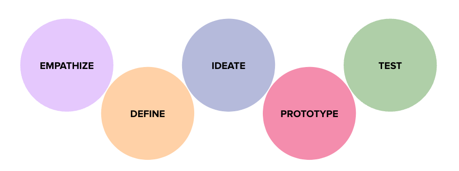

[!NOTE]
In Spring 2026, COMP5270 is on Canvas -- not on Blackboard nor on this site. 
If you're a UML student: While this website may be a useful resource, it may not match the most up-to-date course content you'll find on Canvas.
If you're just perusing: Feel free to email me if you'd like to see the newer materials. 
I will try to update this site to match the Spring 2026 version of the course later in the semester.

# Home

Welcome! This website is the **main hub of online content** for COMP5270 at UML in Spring 2025.

Here, you can find the syllabus, a living schedule, descriptions of all assigments, links to readings and slides, and a list of resources.

Assignment submission, grading, and announcements will be done through [Blackboard](https://uml.umassonline.net/ultra/courses/_62886_1/cl/outline).

<!--fix path-->
